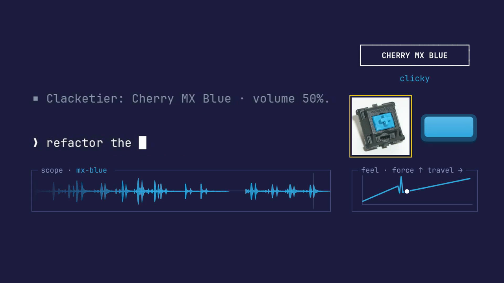

# Clacketier

Real mechanical keyboard sounds under every key you type into Command Code.
Cherry MX Blue, Brown or Red, a few milliseconds after each key, keeping up
with the fastest typing.

[](docs/clacketier.mp4)

▶ [Watch it with sound](docs/clacketier.mp4) (33 s)

The sounds are real recordings of Cherry MX switches with ABS keycaps, from
the [Mechvibes](https://github.com/hainguyents13/mechvibes) project (MIT).
Zero runtime dependencies.

## Try it

Needs a Command Code release with the `keypress` mod event. On older releases
the mod loads but stays silent.

```bash
# Install it for every session, from npm
cmd mods add clacketier -g

# Or straight from GitHub
cmd mods add vipulgupta2048/clacketier -g

# Or try it for one session from a clone
git clone https://github.com/vipulgupta2048/clacketier
cmd --mod ./clacketier/index.ts
```

It's on from the start with Cherry MX Blue at half volume. Type.

| Command | What it does |
| --- | --- |
| `/clacketier` | Status, and every keyboard |
| `/clacketier blue` · `brown` · `red` | Switch keyboard, and hear it |
| `/clacketier pick` | Choose a keyboard from a list |
| `/clacketier volume 30` | How loud, 0 to 100 |
| `/clacketier off` · `on` | Stop or start the clicks |

| Keyboard | Sounds like |
| --- | --- |
| Cherry MX Blue | Clicky: a loud, crisp click on every key |
| Cherry MX Brown | Tactile: a quiet bump, no click |
| Cherry MX Red | Linear: smooth, deeper and softer |

Letters rotate through eight recorded keys so a run never sounds like a loop;
space, enter and backspace have their own sounds. Arrow keys and shortcuts stay
quiet. A paste is one click.

It stays quiet in CI, over SSH (the clicks would play on the remote machine),
and when `CLACKETIER=off`. `CLACKETIER=on` overrides the CI and SSH guesses.

## What it can see

Command Code tells the mod what *kind* of key was pressed (a character, space,
enter, backspace, a paste) and never which key. Clacketier can't read what you
type.

## How it keeps up

Starting a player per key is far too slow: `afplay` takes about a second to
start on macOS. So on macOS Clacketier runs one long-lived player
(`players/macos-key-player.js` under `osascript`), an AVAudioEngine with a
sampler per sound, loaded when the session starts. Each key is one line
appended to a queue file the player polls every 2 ms, and a click starts about
3 ms after the key. Keys that arrive together (fast typing, or Command Code
busy drawing) are spaced 15 ms apart so they sound like separate presses, and a
key more than 120 ms late is dropped, never queued: nothing clicks after you
stop.

On Linux and Windows each key goes through Command Code's audio player
(`paplay`/`aplay`, PowerShell), at most four at once and 18 ms apart.

## Develop

```bash
pnpm install
pnpm test        # keys, prefs, /clacketier, the player protocol, and the mod through a stub of the mod API
pnpm typecheck
```

`src/mod-api.ts` declares the slice of Command Code's `ModApi` this mod uses,
so the project typechecks on its own.

The sounds in `sounds/` are cut from the Mechvibes packs by
`scripts/cut-keyboard-sounds.mjs` (press only, attack first, loudness matched;
needs ffmpeg). See `sounds/LICENSE`.

## License

MIT. The keyboard recordings are MIT too, from Mechvibes: see `sounds/LICENSE`.
The switch photos in the video are public domain (Daniel Beardsmore, Wikimedia
Commons).
