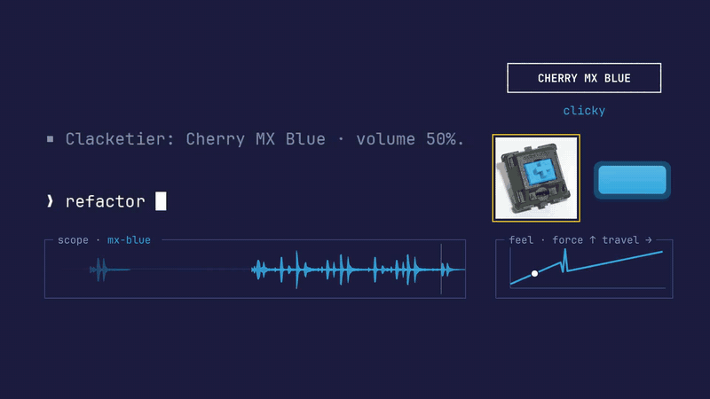
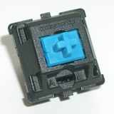
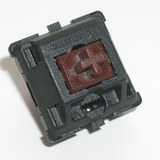
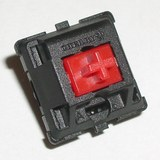

<div align="center">

# Clacketier

**Your terminal, with the sound of a real mechanical keyboard.**

Every key you type into Command Code clicks like a Cherry MX switch: real recordings, a few milliseconds after the key, at any typing speed.

<a href="docs/clacketier.mp4"></a>

**[▶ Watch the 33-second video with sound](docs/clacketier.mp4)**

</div>

## Install

```bash
cmd mods add clacketier -g
```

That's it. It starts on Cherry MX Blue at half volume. Start typing.

## Pick your switch

<table>
<tr>
<td align="center" valign="top" width="33%"><br><b>Cherry MX Blue</b><br>Clicky. A crisp click on every key.<br><code>/clacketier blue</code></td>
<td align="center" valign="top" width="33%"><br><b>Cherry MX Brown</b><br>Tactile. A soft bump, no click.<br><code>/clacketier brown</code></td>
<td align="center" valign="top" width="33%"><br><b>Cherry MX Red</b><br>Linear. Smooth, deeper, softer.<br><code>/clacketier red</code></td>
</tr>
</table>

Every switch is a real recording of that switch with ABS keycaps, from the [Mechvibes](https://github.com/hainguyents13/mechvibes) project. Letters rotate through eight recorded keys, so a long run never sounds like a loop. Space, Enter and Backspace each have their own sound.

## Commands

| Command | What it does |
| --- | --- |
| `/clacketier` | Shows what's playing and every keyboard |
| `/clacketier blue` · `brown` · `red` | Switch keyboards, and hear a sample |
| `/clacketier pick` | Choose a keyboard from a list |
| `/clacketier volume 30` | Set the volume, 0 to 100 |
| `/clacketier off` · `on` | Stop or start the clicks |

Your choice is remembered across sessions.

## Questions

**Can it see what I type?**
It only ever uses the *kind* of key you pressed (a letter, space, enter, backspace, a paste), never which key, and it never stores, logs or sends what you type. On Command Code releases with the `keypress` mod event, that's all Command Code tells it. On older releases Clacketier reads the terminal's input itself to tell the kinds apart; the characters pass through and are dropped. (On macOS the player gets one short line per click through a temporary file that is emptied whenever you pause and deleted when the session ends.) Set `CLACKETIER_STDIN=off` to turn that fallback off.

**Does it lag when I type fast?**
Not on macOS: a click reaches the speaker within about 15 ms of the key. Keys that arrive together still click separately, and a click that would land late is skipped rather than queued, so nothing keeps clicking after you stop.

**Does it work on Linux and Windows?**
Yes, through Command Code's own audio player (`paplay` or `aplay` on Linux, PowerShell on Windows). Each click starts that player, so clicks trail fast typing a little on Linux and noticeably on Windows. macOS gets a dedicated low-latency player.

**What about SSH and CI?**
It stays quiet there, since the clicks would play on a machine nobody is sitting at. Set `CLACKETIER=on` to force it, or `CLACKETIER=off` to silence it anywhere.

**Paste a whole paragraph?**
One click, not three hundred. Arrow keys and shortcuts stay quiet.

## Other ways to install

```bash
# Straight from GitHub
cmd mods add vipulgupta2048/clacketier -g

# Just for one session, from a clone
git clone https://github.com/vipulgupta2048/clacketier
cmd --mod ./clacketier/index.ts
```

<details>
<summary><b>How it keeps up</b> (for the curious)</summary>

Starting an audio player per key is far too slow: `afplay` takes about a second to start on macOS. So on macOS Clacketier runs one long-lived player (`players/macos-key-player.js` under `osascript`): an AVAudioEngine with a sampler per sound, loaded when the session starts. Each key is one line appended to a queue file that the player polls every 2 ms. Keys that arrive together (fast typing, or Command Code busy redrawing) are spaced 15 ms apart so they sound like separate presses, and a key more than 120 ms late is dropped.

On Linux and Windows each key goes through Command Code's audio player, at most four at once and 18 ms apart.

</details>

<details>
<summary><b>Develop</b></summary>

```bash
pnpm install
pnpm test        # keys, prefs, /clacketier, the player protocol, and the mod through a stub of the mod API
pnpm typecheck
```

`src/mod-api.ts` declares the slice of Command Code's `ModApi` this mod uses, so the project typechecks on its own. The sounds in `sounds/` are cut from the Mechvibes packs by `scripts/cut-keyboard-sounds.mjs` (press only, attack first, loudness matched; needs ffmpeg).

</details>

## License

MIT. The keyboard recordings are MIT too, from Mechvibes (see `sounds/LICENSE`). The switch photos are public domain, by Daniel Beardsmore on Wikimedia Commons.
